<h1 align="center">Merhaba, ben Sueda 👋</h1>

  <b>Bilgisayar Mühendisi · Mobil & Web Geliştirici</b> 
  Ankara, Türkiye

  Fikirden mağazaya kadar uçtan uca mobil uygulamalar geliştiriyorum. 
  Flutter ve React Native ile Android/iOS uygulamaları, PHP/Symfony ile web uygulamaları yazıyorum.

  
  

---

## 🎯 Odak Alanım

Projelerimin büyük çoğunluğu **mobil uygulama geliştirme** üzerine. Yayına hazır uygulamalarımın yanında
**PHP/Symfony ile web geliştirme** ikinci ana alanım.

| Alan | Projeler | |
| --- | --- | --- |
| 📱 **Mobil Uygulama** (Flutter, React Native) | Çeşnicibaşı · Sumera Pomodoro · Hangi Yağ? | 🟩🟩🟩🟩🟩 |
| 🌐 **Web & Yönetim Paneli** (PHP, Symfony) | EgzozGross · Workiva · dictionary_project | 🟩🟩🟩🟩⬜ |
| 🖥️ **Masaüstü** (C#, WinForms) | KanBaS · Visual Programming | 🟩🟩⬜⬜⬜ |
| 🎓 **Bilgisayar Mühendisliği temelleri** | C, Veri Yapıları, Java, Assembly, MATLAB görüntü işleme | 🟩🟩⬜⬜⬜ |

---

## 🌍 Yayındaki Projeler

  
  
  
  

---

## 🚀 Öne Çıkan Projeler

### 🍲 Çeşnicibaşı — Yapay zekâ destekli mutfak asistanı

  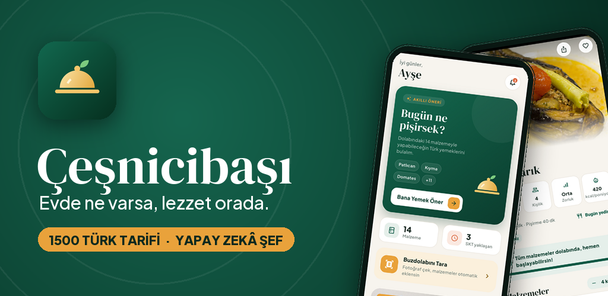

Buzdolabındaki malzemelere göre **1500 Türk yemeği tarifi** arasından en uygun olanları bulan Android uygulaması.
Dolaptaki ürünleri fotoğrafla tanıyor, son kullanma tarihlerini hatırlatıyor ve alışveriş listesini reyon reyon hazırlıyor.

- 📷 **Gemini** ile buzdolabı fotoğrafından malzeme tanıma
- 🧊 Eldeki malzemeyle eşleşme oranına göre tarif sıralama, "%100 Hazır" önerileri
- 👩‍🍳 Adım adım pişirme modu, zamanlayıcı, porsiyon ayarı
- 💎 Abonelikli **Plus**: yapay zekâ şef, haftalık yemek planı, beslenme takibi
- 🌍 4 dil (Arapça ile sağdan sola destek), koyu tema, **Supabase** ile bulut

  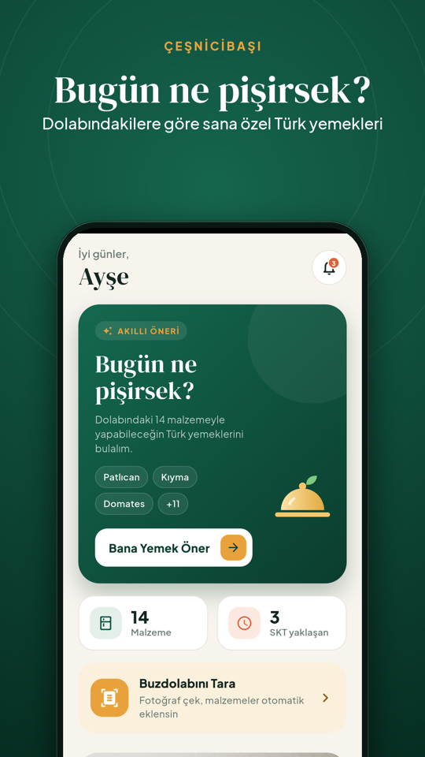
  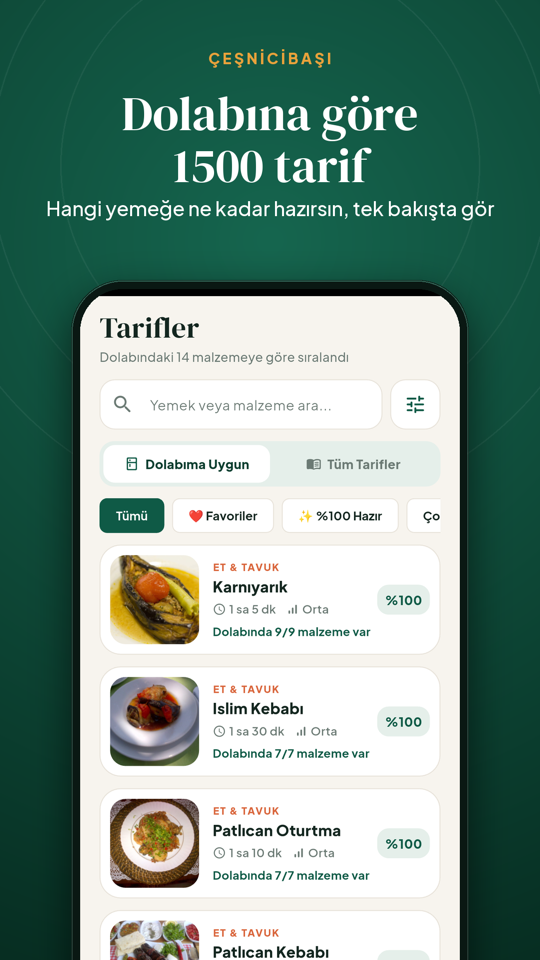
  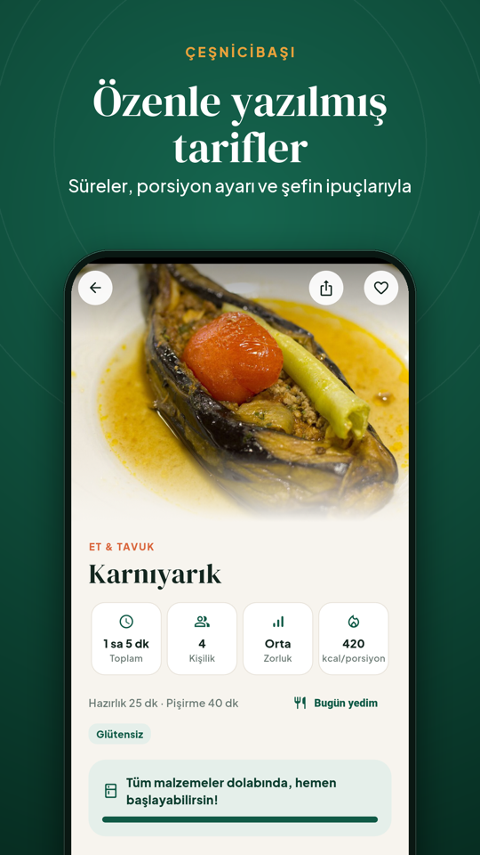

  
  
  
  
  

---

### ⏱️ [Sumera Pomodoro](https://github.com/SuedaTekin/Sumera_Pomodoro) — Odaklan. Dinlen. İlerlemeni gör.

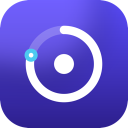

Her pomodoroda kişisel gökyüzüne bir yıldız ekleyen, oyunlaştırılmış bir odaklanma uygulaması.

- ✨ **Gökyüzüm:** her pomodoro bir yıldız, her gün bir takımyıldız; 14 rozet ve akıllı içgörüler
- ⏲️ Arka planda bile kaymayan sayaç, zamanlanmış bildirimler, görevler ve günlük hedef
- 📊 7/30 günlük istatistik grafikleri, gün serisi, görev bazlı dağılım
- 🎧 Program ile üretilmiş, telifsiz odak sesleri (yağmur, okyanus, beyaz/pembe/kahverengi gürültü)
- ☁️ **Supabase** ile çevrimdışı öncelikli bulut yedekleme
- 🛰️ [pomodoro-config](https://github.com/SuedaTekin/pomodoro-config) ile mağaza güncellemesi olmadan **uzaktan yönetim** (duyuru, metinler, özellik açma/kapama, zorunlu güncelleme)
- 🌍 6 dil

  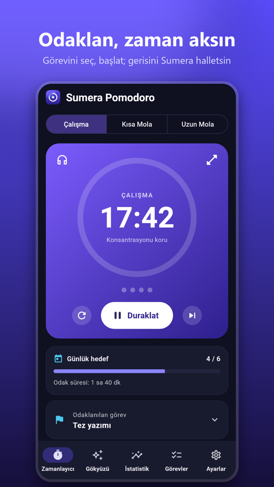
  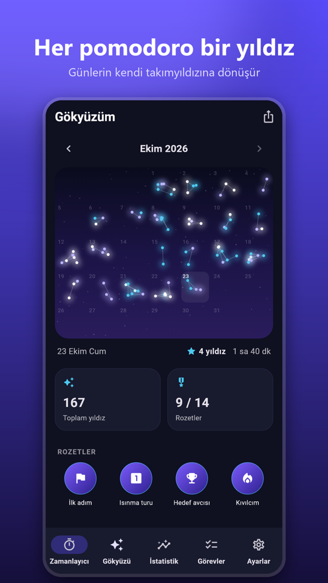
  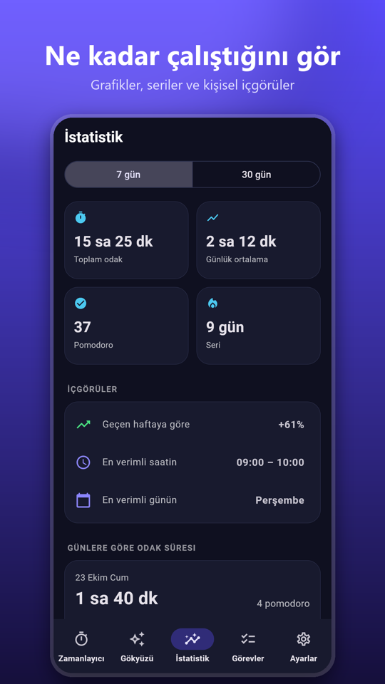

  
  
  
  

---

### 🛢️ [Hangi Yağ?](https://hangiyag.com.tr/) — Motor yağı sorgulama uygulaması

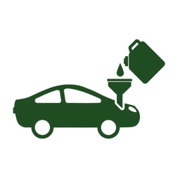

Aracın marka, model ve yılına göre doğru motor yağını bulan [hangiyag.com.tr](https://hangiyag.com.tr/) için Android ve iOS uygulaması.
250+ marka ve 165.000+ araç varyantı, şasi numarasıyla sorgu ve muadil yağ karşılaştırması.

- 📱 **Expo + React Native** ile tek kod tabanından Android ve iOS
- 🔗 Site içi / harici link yönetimi, Android geri tuşu, çekip yenileme, çevrimdışı ekranı
- ☁️ **EAS** ile bulutta derleme ve mağaza gönderimi

  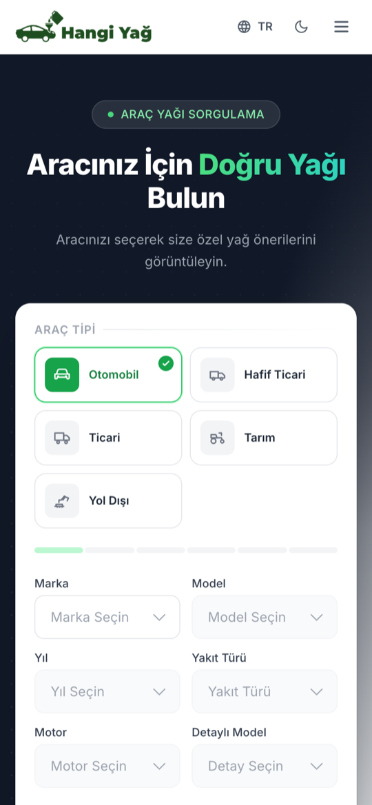
  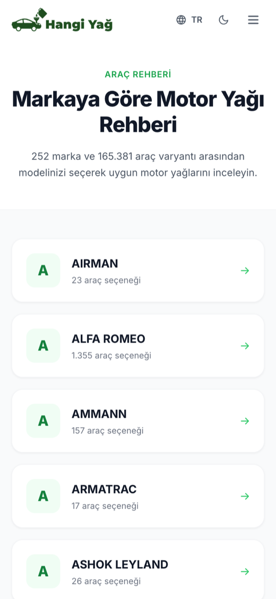
  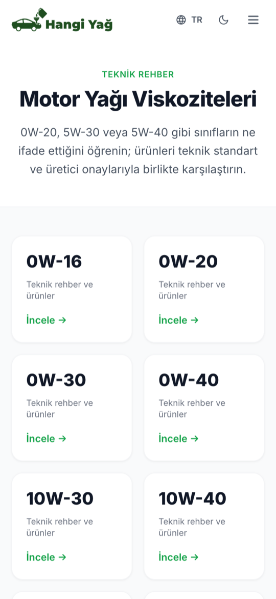

  
  
  
  

---

### 🚗 [EgzozGross](https://egzozgross.com/) — Toptan egzoz parçaları web sitesi ve yönetim paneli

  <a href="https://egzozgross.com/">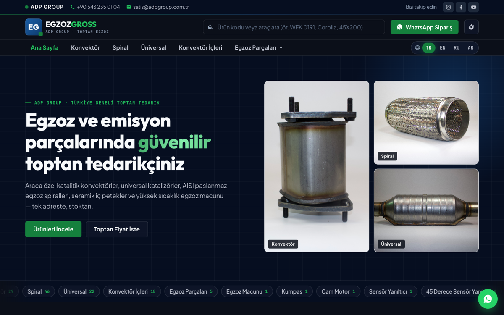</a>

ADP Group için katalitik konvektör, egzoz spirali, universal katalizör, seramik iç petek ve egzoz macunu
toptan satışı yapan kurumsal ürün kataloğu sitesi.

- 🗂️ Kategori, ürün ve çoklu ürün görseli yönetimi; Euro normu filtreleri, ürün kodu / araç ile arama
- 🛠️ **EasyAdmin** ile yönetim paneli: ürünler, kategoriler, ana sayfa içerikleri, site ayarları, kullanıcılar
- 📈 Günlük ziyaret istatistikleri
- 🌍 4 dil: Türkçe, İngilizce, Rusça, Arapça (sağdan sola)
- 💬 WhatsApp ile sipariş / fiyat sorma
- 🚀 Nginx + PHP-FPM sunucu yapılandırması ve yayın süreci

  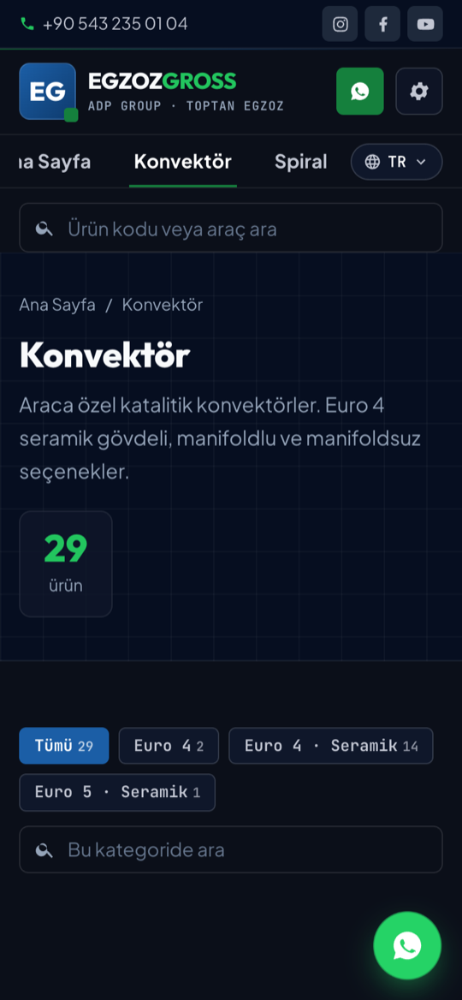
  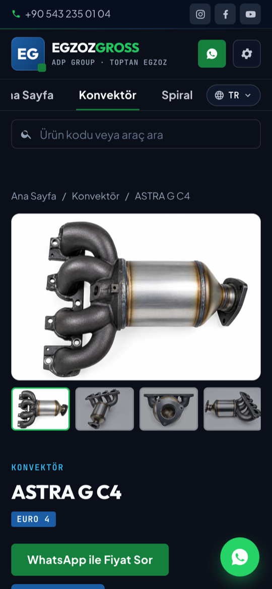

  
  
  
  
  
  
  

---

## 🧰 Diğer Projeler

| Proje | Açıklama | Teknolojiler |
| --- | --- | --- |
| [**Workiva**](https://github.com/SuedaTekin/Workiva) | Proje ve görev yönetimi web uygulaması: kullanıcı kaydı/girişi, projeler, görevler, raporlar ve panel | PHP · Symfony · Twig · Docker |
| [**dictionary_project**](https://github.com/SuedaTekin/dictionary_project) | Symfony tabanlı sözlük web uygulaması | PHP · Symfony · Twig · Docker |
| [**KanBaS**](https://github.com/SuedaTekin/KanBaS) | Kan bankası yönetim sistemi: bağışçı, hasta, kan stoku, bağış ve transfer işlemleri | C# · WinForms · SQLite |
| [**image-processing-matlab**](https://github.com/SuedaTekin/image-processing-matlab) | Min/max/ortalama/medyan filtreleri, ölçekleme ve öteleme | MATLAB |
| [**microprocessors**](https://github.com/SuedaTekin/microprocessors) | Mikroişlemci dersi çalışmaları | Assembly |
| [**Data-Structures**](https://github.com/SuedaTekin/Data-Structures) · [**C-Programming-Language**](https://github.com/SuedaTekin/C-Programming-Language) | Veri yapıları ve C ile algoritma çalışmaları | C |
| [**Object-Oriented-Programming**](https://github.com/SuedaTekin/Object-Oriented-Programming) | Nesne yönelimli programlama çalışmaları | Java |
| [**Visual-Programming**](https://github.com/SuedaTekin/Visual-Programming) | Görsel programlama ödev ve uygulamaları | C# |

---

## 🛠️ Teknolojiler

**Mobil**

  
  
  
  
  
  

**Web & Backend**

  
  
  
  
  
  

**Veritabanı, Bulut & Yapay Zekâ**

  
  
  
  
  

**Diğer Diller & Araçlar**

  
  
  
  
  
  
  

---

## 💡 Çalışma Şeklim

- **Uçtan uca ürün:** tasarım, geliştirme, mağaza görselleri ve metinleri, gizlilik politikası ve yayın süreci
- **Yayından sonra da yönetilebilir uygulamalar:** uzaktan ayar dosyaları ile mağaza onayı beklemeden içerik ve özellik güncelleme
- **Çevrimdışı öncelikli** veri yapısı ve gizliliğe saygılı tasarım
- **Çok dilli** arayüzler (Türkçe, İngilizce, Almanca, Arapça, İspanyolca, Fransızca, Portekizce)

  

